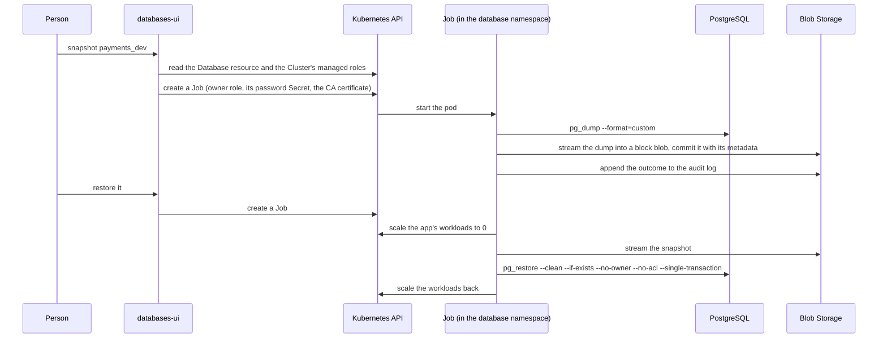

# databases-ui

Let app teams snapshot, restore and clone their own PostgreSQL databases on
[CloudNativePG](https://cloudnative-pg.io/), without asking the platform team. People sign in with
Entra ID, see the databases their team owns, and every action runs as a Kubernetes Job next to the
database.

- **Snapshots on demand.** `pg_dump` in the custom format, streamed straight into Azure Blob
  Storage with who took it and why. Nothing touches a disk, and nothing leaves the cluster.
- **Restore in place or into a copy.** `pg_restore` in a single transaction: if anything fails,
  nothing changes. In place, the app's workloads are scaled to 0 first and back afterwards; into a
  copy, a second database `<name>_copy` appears next to it, created and dropped by CloudNativePG.
- **Clone across environments.** Restore a snapshot of acc into dev, for instance, where the
  catalog allows it.
- **Production is careful.** A restore in a production environment waits for a second person to
  approve it, and snapshots taken there can't be downloaded.
- **An audit log** of who asked for what, who approved it and how it ended, per environment.
- **No superuser.** Each Job connects as the database's owner role, with the password from that
  managed role's Secret. The server itself never reads a password.

## How it works



The server reads `Database` resources (`postgresql.cnpg.io/v1`) and their `Cluster`, creates Jobs,
and lists snapshots and the audit log in storage. The Jobs run this app's own image, which carries
the PostgreSQL client, as `python -m databases_ui job`. A Job's pod reads the owner's password from
the kubelet, verifies the server's certificate against the cluster's CA (`verify-full`), and talks
to storage with its own workload identity.

## The catalog

One YAML file says which environments the app reaches and which team acts on which database (see
[`examples/catalog.yaml`](examples/catalog.yaml)):

```yaml
environments:
  - name: dev
    # The CloudNativePG Cluster (default: the environment's name) and its namespace (default:
    # database), which holds the Database resources, the role Secrets and the Jobs.
    cluster: dev
    namespace: database
    storage:
      url: https://<account>.blob.core.windows.net/dev-snapshots
    cloneFrom: [acc]       # environments whose snapshots may be restored here
  - name: acc
    # in-cluster (default), none (only read its snapshots, to clone from), or another cluster's
    # API server: {server, caFile, tokenFile}.
    kubernetes: none
    storage:
      url: https://<account>.blob.core.windows.net/acc-snapshots
  - name: prd
    production: true       # restores wait for a second person; no downloads
    cluster: prod
    storage:
      url: https://<other account>.blob.core.windows.net/prd-snapshots

teams:
  - id: payments
    name: Payments
    groups: [6f1c2b7e-3a44-4d0e-9a51-2b8e0c7d9f10]   # Entra ID group object ids
    databases:
      - name: payments_{env}                        # the Database resource's spec.name
        environments: [dev, acc, prd]               # default: every environment
        workloads:                                  # scaled to 0 for a restore in place
          - deployment/{env}-payments/payments-api
```

`{env}` is the environment's name. Write lists that use it as block lists: YAML reads braces inside
`[ ]` as a mapping. Check the file in CI before it reaches the server, which refuses to start with
a catalog that does not hold together:

```bash
docker run --rm -v "$PWD/catalog.yaml:/catalog.yaml:ro" ghcr.io/magmamoose/databases-ui:<tag> check /catalog.yaml
```

## Who does what

| | Sees | Can |
|---|---|---|
| A team's members | their databases, their snapshots, Jobs and audit entries | snapshot, restore, clone, download outside production, approve a teammate's production restore |
| App role `Admin` | every database in every environment | everything a member can |
| App role `Auditor` | everything | nothing: read-only |

## What a restore does

- **One transaction.** `pg_restore --single-transaction`: on any error, the database is as it was.
- **Objects in the snapshot are replaced; others stay.** `--clean --if-exists` drops and recreates
  what the snapshot holds. A table created after the snapshot was taken is left alone, so an app
  whose migrations created it may find it already there.
- **No owners or grants from the snapshot.** `--no-owner --no-acl`: everything restored belongs to
  the database's owner role, so a snapshot moves between environments whose roles differ.
- **Extensions stay as they are.** Snapshots leave extensions out (`--exclude-extension=*`): the
  owner role can't drop one the operator created. The target database needs the same extensions;
  a copy gets those its `Database` resource lists.
- **In place, the workloads go first.** Each listed Deployment or StatefulSet is scaled to 0, its
  replica count kept in the annotation `databases-ui/replicas-before-restore`, and other sessions
  of the owner role are ended. Afterwards it gets its count back, also when the restore failed. If
  the Job itself dies halfway, the next restore restores the count from the annotation. A GitOps
  tool that sets `replicas` may scale the app back up during the restore; the transaction keeps the
  data right either way.
- **The owner must read everything.** `pg_dump` runs as the owner role, so objects in the database
  that belong to other roles and that it can't read stop the snapshot.

## Setting up

### 1. Storage

A container per environment, for example in a storage account per environment, with:

- a lifecycle rule that deletes blobs under `snapshots/` after as many days as snapshots should
  live; the audit log is under `audit/`, one append blob per month;
- network rules that admit the clusters' egress addresses: every transfer happens inside a
  cluster, the browser's downloads included, which the server streams;
- Storage Blob Data Contributor on the container for the app registration below.

A Job that clones reads the source environment's container, so that container must admit the
target cluster and grant the same app reading rights.

### 2. The Entra ID app registration

- Platform **Web**, redirect URI `https://<host>/auth/callback`.
- **Group claims** in the ID token, emitting group object ids, best restricted to *groups assigned
  to the application*; assign each team's group to the app. A person in more groups than fit in a
  token is refused with a message that says so.
- App roles `Admin` and `Auditor`, assigned to who needs them.
- Federated credentials, audience `api://AzureADTokenExchange`, issuer your cluster's
  service-account issuer, for the server
  (`system:serviceaccount:<release namespace>:<release name>`) and for the Jobs in each namespace
  (`system:serviceaccount:<namespace>:databases-ui-job`). No secret to rotate. The server can use a
  client secret instead; the Jobs then reach storage through a SAS (`storage.sas`), which suits
  Azurite and tests more than production.

### 3. Kubernetes

The chart installs, in each namespace of `rbac.namespaces` (the namespaces of the in-cluster
environments):

- a Role for the server: Database resources (get, list, create and delete, for copies),
  Clusters (get), Jobs (get, list, create, patch, delete) and pods (list); no Secrets;
- the Jobs' service account, `databases-ui-job`;
- with `networkPolicy.databases.enabled`, a NetworkPolicy that lets the Jobs' pods reach
  PostgreSQL on the CloudNativePG pods, for clusters that admit only listed clients.

In each namespace of `jobs.scaleNamespaces`, the Jobs' service account may get and patch
Deployments and StatefulSets and list pods, to scale the workloads of a restore in place.

Creating Jobs in a namespace lets a client mount any Secret there, so the chart also installs a
ValidatingAdmissionPolicy (`jobPolicy`, Kubernetes 1.30+) that holds the Jobs the server creates to
what it builds: this image, run as `job`; one owner's password and never a `*-superuser` Secret; the
CA certificate and no other Secret file; `verify-full` TLS to a `-rw` service in the Job's own
namespace; and only the catalog's storage.

### 4. Install

```bash
helm install databases-ui oci://ghcr.io/magmamoose/charts/databases-ui \
  --namespace databases-ui --create-namespace \
  --set azure.tenantId=<tenant> --set azure.clientId=<client id> \
  --set config.publicOrigin=https://databases.example.com \
  --set-file catalog.content=catalog.yaml \
  --set 'jobs.scaleNamespaces={dev-payments}' \
  --set ingress.enabled=true
```

Every value is described in [`charts/databases-ui/values.yaml`](charts/databases-ui/values.yaml).
The catalog can also come from your own ConfigMap (`catalog.existingConfigMap`); the server reads
it at startup, and the chart rolls the pods when its own copy changes.

## Configuration

| Variable | |
|---|---|
| `AZURE_TENANT_ID`, `AZURE_CLIENT_ID` | the app registration |
| `AZURE_FEDERATED_TOKEN_FILE` or `AZURE_CLIENT_SECRET[_FILE]` | its credential |
| `AZURE_AUTHORITY_HOST` | a sovereign cloud's login host; default `https://login.microsoftonline.com` |
| `DATABASES_UI_PUBLIC_ORIGIN` | where people open it, `https://host` |
| `DATABASES_UI_SESSION_KEY[_FILE]` | at least 32 characters, the same on every replica |
| `DATABASES_UI_SESSION_HOURS` | 1 to 24, default 8 |
| `DATABASES_UI_CATALOG` | the catalog file |
| `DATABASES_UI_JOB_IMAGE` | the image the Jobs run: this app's own |
| `DATABASES_UI_JOB_SERVICE_ACCOUNT` | the Jobs' service account; default `databases-ui-job` |
| `DATABASES_UI_STORAGE_SAS[_FILE]` and `DATABASES_UI_STORAGE_SAS_SECRET` | instead of Entra ID: a SAS for the server, and `<secret>/<key>` of the same SAS in each Job namespace |
| `DATABASES_UI_ADMIN_ROLE`, `DATABASES_UI_AUDITOR_ROLE` | app role values; default `Admin`, `Auditor` |
| `DATABASES_UI_BRAND_ACCENT`, `_ACCENT_TEXT`, `_ACCENT_DARK`, `_ACCENT_TEXT_DARK` | your colours as `#rrggbb` |

`python -m databases_ui [serve | check <catalog> | job]`: the server (default), the catalog check,
and a Job's work.

## Security

- **Backend for frontend.** The browser holds no token it can read: the session is an AES-GCM
  sealed, `__Host-`, `HttpOnly`, `Secure`, `SameSite=Strict` cookie, and every write also needs a
  CSRF token and this origin. No inline script or style, under a strict Content Security Policy.
- **Decided on the server.** Who may see and do what follows from the catalog and the groups in
  the person's ID token, checked on every call.
- **No passwords in the server.** It reads no Secret; a Job's pod gets the owner's password from
  the kubelet, and the admission policy above keeps the server's Jobs to what it builds.
- **A production restore takes two people.** It is created suspended and starts only when someone
  else who may act on the database approves it; a Job's pod template can't change after
  creation, so what runs is what was asked for. Unapproved requests expire after a day.
- **Snapshots stay in the cluster's storage.** Downloads, outside production only, stream through
  the server and are recorded in the audit log.

## Development

```bash
uv sync
uv run pytest
uv run python -m databases_ui check examples/catalog.yaml
cd frontend && npm install && npm run dev   # the UI on 5173, the API proxied to 8080
```

[`e2e/run.py`](e2e/run.py) runs every action against a real cluster with CloudNativePG and
Azurite; CI runs it on kind:

```bash
k3d cluster create dbui
helm install cnpg cloudnative-pg --repo https://cloudnative-pg.github.io/charts --version 0.29.1 \
  --namespace cnpg-system --create-namespace --wait
docker buildx bake app-local && k3d image import databases-ui:dev -c dbui
uv run python e2e/run.py
```

## Licence

Apache-2.0, see [LICENSE](LICENSE).
